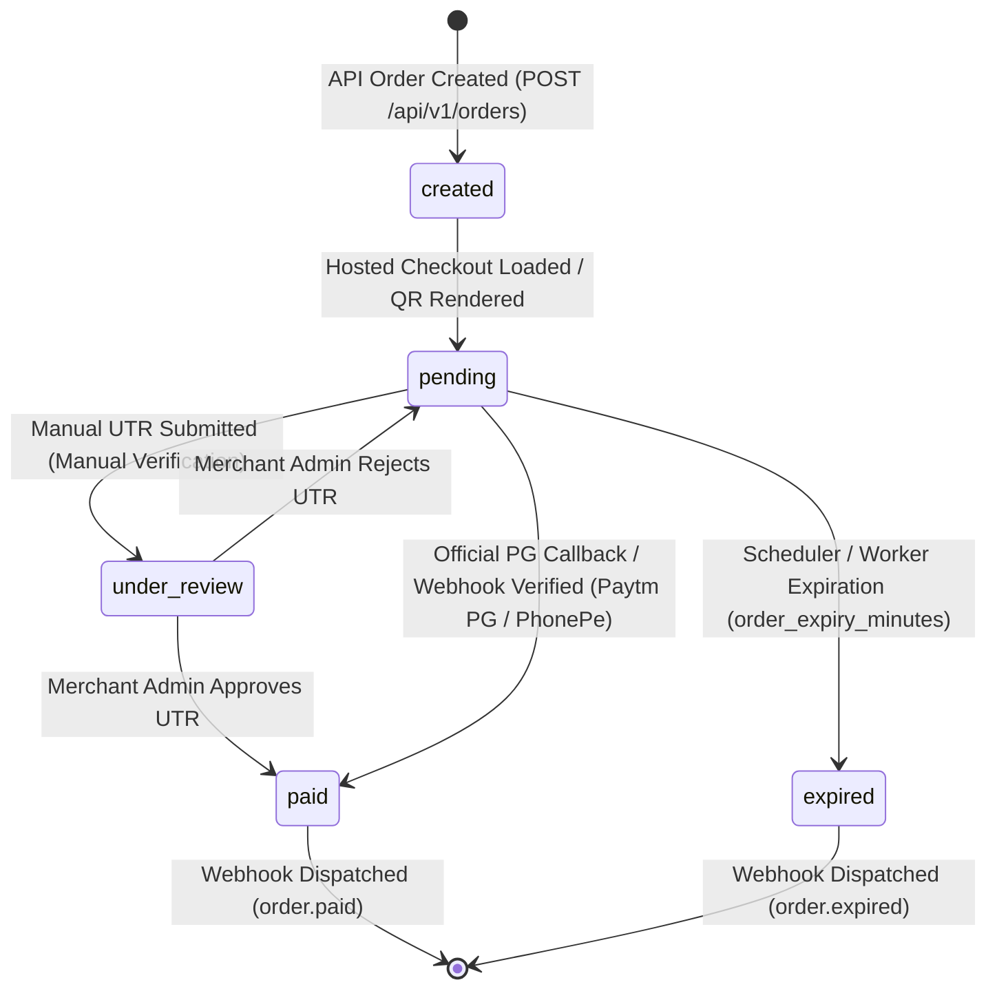

# PHASE 11A — REPOSITORY AUDIT REPORT
## UPI Gateway Adoption & Integration Audit
**Repository:** `https://github.com/mynkdev-21/upi-gateway`  
**Developer / Maintainer:** Mayank Singh (`mynkdev-21`)  
**Target Platform:** STARX ALPHA LABS (`https://starx-alpha-labs.vercel.app/`)  
**Auditor:** Senior Payment Infrastructure & Application Security Engineering Team  
**Date:** November 11, 2026  
**Audit Classification:** CONDITIONAL PASS (Approved for integration subject to mandatory operational guardrails)

---

### 1. Executive Summary & Attribution
StarX Alpha Labs has undertaken an exhaustive, source-code level architectural and security audit of the open-source **UPI Gateway** project authored by **Mayank Singh (`mynkdev-21`)**.

- **Original Repository:** `https://github.com/mynkdev-21/upi-gateway`
- **Release Status:** `v1.1.0-RC` (rolling release candidate on `main` branch)
- **License Compliance:** MIT License (Copyright © 2026 Mayank Singh). The license grants full rights to use, copy, modify, merge, publish, and integrate, provided the original copyright notice and permission notice are preserved in all copies or substantial portions of the software. StarX Alpha Labs strictly retains full attribution and preserves all original copyright notices.
- **Architectural Boundary:** The UPI Gateway is audited and adopted as an **independent standalone service** running on Laravel 12 / PHP 8.2+ / MySQL 8.0+. It is **NOT** converted to TypeScript/Next.js, its code is **NOT** merged into the StarX Alpha Labs Vercel deployment, and it does **NOT** share databases with Supabase or StarX Flow. Communication occurs strictly over authenticated REST APIs and HMAC-SHA256 signed webhooks.

---

### 2. Codebase Structure & Component Inventory

| Directory / Layer | Purpose & Findings |
|---|---|
| `app/Http/Controllers/Api/` | `OrderApiController.php`, `AccountApiController.php`. High quality validation, client order ID uniqueness scoped per-merchant and per-environment, strict type checking, and domain allowlist enforcement. |
| `app/Http/Middleware/` | `AuthenticateApiKey.php`, `EnsureActive.php`, `EnsureAdmin.php`, `SecurityHeaders.php`, `RedirectIfInstalled.php`. Employs timing-attack safe comparisons (`hash_equals`), multi-tier rate limiting (per-IP, per-key, brute-force IP lockout), and UUID request tracing. |
| `app/Services/Verifiers/` | Pluggable verification strategies: `PaytmPgVerifier`, `PhonePePgVerifier`, `HostedCheckout`, `ManualVerifier`, and `PaytmBusinessVerifier`. Strict separation between official gateway APIs and unofficial status polling. |
| `app/Services/` | `OrderService.php`, `WebhookOutboxService.php`, `WebhookOutboxDispatcher.php`, `VerificationLease.php`. Robust distributed locking (`Cache::lock`), transaction-bound outbox recording, and monotonic sequence counters. |
| `app/Jobs/SendWebhook.php` | Queue worker delivering webhook events with DNS-rebinding SSRF mitigation (`SafeUrl`, `CURLOPT_RESOLVE` IP pinning), exponential backoff (`[30, 120, 600, 1800, 3600]`), and response status tracking without persisting sensitive bodies. |
| `app/Support/WebhookSignature.php` | Timestamped HMAC-SHA256 signature generator and parser (`t=<timestamp>,v1=<signature>`) with default 5-minute replay tolerance window. |
| `database/migrations/` | Comprehensive MySQL schema featuring InnoDB row-level locking, foreign key cascading, and database-level unique constraints. |
| `tests/Feature/` | Over 40 comprehensive feature tests covering isolation, concurrency, outbox dispatch, SSRF, replay protection, and session encryption. |

---

### 3. Payment Lifecycle & State Machine Audit

1. **Order Creation:** Merchant sends `amount` (1 to 100,000 INR), `client_order_id` (max 64 chars alphanumeric), and optional metadata. The gateway allocates an internal order number `ORD...`, creates a dynamic UPI URI (`upi://pay?pa=...&am=...&tr=...`), and issues a hosted payment URL.
2. **Environment Separation:** API keys beginning with `test_key_` automatically trigger `sandbox` mode. Live orders require `key_...` and are isolated in both database queries and webhook credentials.
3. **Account Load Balancing & Rotation:** For merchants with multiple UPI accounts, the gateway balances traffic across active accounts, enforcing daily transaction limits. If a specific account is requested via `payment_account_id`, rotation is bypassed and the system fails fast if the requested account is unavailable.
4. **Payment Verification:**
   - **Official Payment Gateways (Paytm PG / PhonePe):** Verification is performed via cryptographic API calls directly to provider servers.
   - **Manual UTR Flow:** Used for direct bank account VPAs. The customer submits their 12-digit bank UTR, transitioning the order to `under_review`. The merchant inspects the bank statement and explicitly approves or rejects the payment.
   - **Unofficial Paytm Business Polling:** Polling of consumer/business web portals. **AUDIT VERDICT: INSECURE FOR COMMERCIAL SLA. MUST REMAIN DISABLED.**

---

### 4. Merchant Isolation & Security Boundaries
- **Query Scoping:** Every order query in `OrderApiController` and web routes is explicitly scoped by `$request->user()->orders()`. Direct ID tampering (Insecure Direct Object Reference - IDOR) is systematically prevented.
- **Credential Storage:** Webhook signing secrets and API secrets are encrypted at rest using Laravel's application key (`APP_KEY`) via AES-256-CBC.
- **Session Protection:** Database session driver encrypts all payloads at rest (`SESSION_ENCRYPT=true`).

---

### 5. Webhook Reliability & Delivery Guarantees
- **Transactional Outbox Pattern:** Webhook intents are written to the database `webhook_outbox` in the exact same database transaction that updates order status to `PAID`. An unavailable queue worker or redis connection cannot drop notifications.
- **At-Least-Once Delivery:** Network drops or consumer 5xx errors trigger 6 retries with exponential backoff.
- **Consumer Requirement:** StarX Alpha Labs webhook receiver must enforce idempotency on `event_id` and order monotonic updates on `event_sequence`.

---

### 6. Audit Verdict
**CONDITIONAL PASS:**
The repository is exceptionally well-architected, robust, and mature. It complies with modern payment engineering best practices. Integration is approved under the condition that:
1. `GATEWAY_ENABLE_PAYTM_BUSINESS` is set to `false`.
2. Dedicated production hosting is provisioned with document root pinned exclusively to `/public`.
3. StarX Alpha Labs communicates strictly server-to-server.
