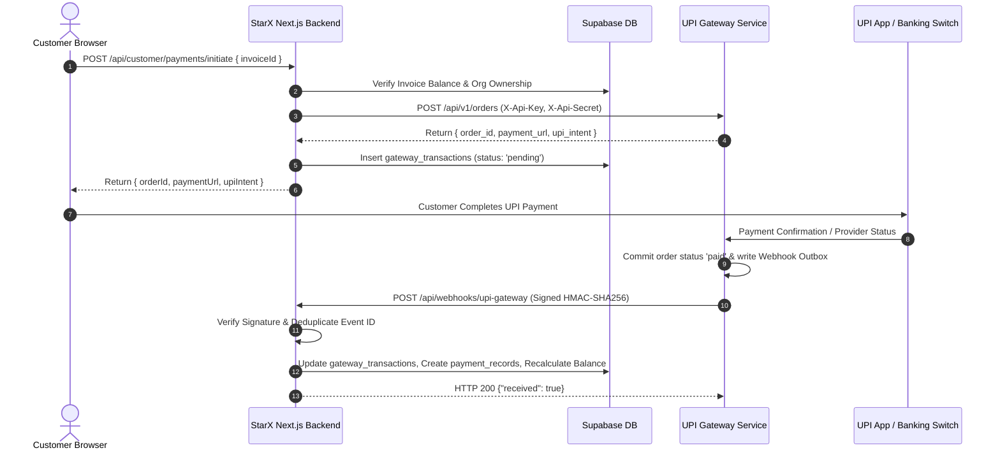

# PHASE 11D — API INTEGRATION REPORT
## StarX Alpha Labs Backend Integration Layer
**Date:** November 11, 2026

---

### 1. Integration Layer Architecture

---

### 2. Client Library (`src/lib/payment-gateway/client.ts`)
- **`createGatewayOrder(params)`**: Issues HTTPS POST request with credentials in headers. Supports timeout cancellation (8s) and structured error parsing.
- **`getGatewayOrderStatus(orderNo)`**: Performs server-side status checks.
- **`verifyWebhookSignature(...)`**:
  - Extracts timestamp `t` and signature `v1`.
  - Rejects headers missing parameters or containing invalid hex digits.
  - Enforces 300-second maximum clock skew window.
  - Reconstructs `${timestamp}.${rawBody}`.
  - Computes HMAC-SHA256 using the configured secret.
  - Performs constant-time buffer comparison (`crypto.timingSafeEqual`) to prevent side-channel timing attacks.

---

### 3. Webhook Receiver (`src/app/api/webhooks/upi-gateway/route.ts`)
- **Raw Body Processing:** Reads the exact unaltered request body via `await req.text()`.
- **Deduplication:** Queries table `gateway_webhook_events` for `event_id`. Duplicate events are immediately acknowledged with `200 OK` (`received: true, duplicate: true`) without re-applying financial modifications.
- **Order Reconciliation:** Matches the transaction via `gateway_order_no` or `client_order_id`.
- **Automatic Ledger Update:** On `order.paid`, records verified receipt in `payment_records` and invokes PostgreSQL trigger `recalculate_invoice_balance(invoice_id)`.
