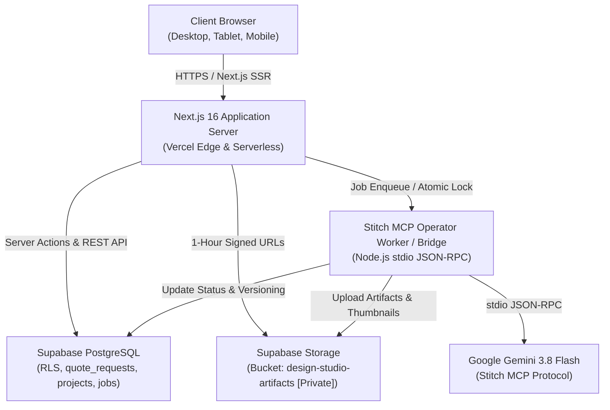

# STARX ALPHA LABS — CURRENT SYSTEM ARCHITECTURE
## Phase 0 Technical Architecture Blueprint

**Version:** 2.0.0-master  
**Timestamp:** November 17, 2026  
**Primary Host:** Vercel (Next.js 16.4.6, Turbopack, React 19)  
**Database & Auth:** Supabase PostgreSQL with Row Level Security (RLS)  
**AI Generation Engine:** Google Stitch MCP (`@_davideast/stitch-mcp`) + Gemini 3.8 Flash

---

### 1. High-Level System Architecture

---

### 2. Core Architectural Layers

1. **Presentation Layer:**
   - Next.js 16 App Router with Turbopack and React 19 Server/Client Components.
   - Tailwind CSS v4 design system with StarX Cosmic Liquid Glass styling (`#030B24`, `#071638`, `#00D9FF`, `#E52BFF`).
   - Framer Motion / Motion for purposeful transitions and interactive state feedback.

2. **Customer Design Studio & AI Discovery:**
   - Guest-first entry via `/design-studio` with persistent `sessionId` stored in `localStorage` and synced with URL queries.
   - 8-Step Discovery & Synthesis Pipeline:
     1. Solution Discovery (Divisions & Industries)
     2. AI Requirement Discovery (Conversational understanding)
     3. Feature & Complexity Analysis (Structured specification)
     4. Plan Selection (Deterministic matching + AI explanation)
     5. Feature Configuration (Authoritative scope customisation)
     6. Design Personalisation (Brand parameters & palette preferences)
     7. AI Blueprint & Prompt Engine (Modular versioned prompt architecture)
     8. Google Stitch Generation & Hero Demo Presentation Workspace

3. **Google Stitch AI Integration Engine:**
   - Isolated stdio JSON-RPC client invoking `generate_screen_from_text` and `edit_screens`.
   - Multi-version artifact tracking (`v1` &rarr; `v2` &rarr; `vN`).
   - Supabase private storage bucket `design-studio-artifacts` with 1-hour signed URL access.

4. **Commercial & Operational Engine:**
   - Quotation and enquiry conversion workflow `/api/quote`.
   - Admin Console (`/admin`) for leads, CRM, quotations, project milestones, and team permissions.
   - Customer Portal (`/customer`) for authenticated clients managing orders, documents, invoices, and design change requests.
