# STARX ALPHA LABS — DESIGN STUDIO 2.0
## Comprehensive Architecture, Functional & Root-Cause Audit Report

**Date:** November 18, 2026  
**Auditor:** Principal Software Architect & Full-Stack Systems Engineer  
**Workspace:** `C:\Web Apps\StarX Alpha Labs`  
**Git Branch:** `feat/portal-transformation`  
**Product Target:** Build with StarX (Design Studio 2.0)  

---

### Executive Summary

An exhaustive audit of the existing Design Studio in `StarX Alpha Labs` was conducted across frontend components, state management, backend APIs, Supabase PostgreSQL schemas, RLS policies, the plan recommendation engine, and Google Stitch MCP integration.

The existing system contained the skeleton of an 8-step wizard (`src/components/design-studio/DesignStudioClient.tsx`, 3,790 lines), but suffered from severe architectural flaws:
1. **Unapplied Database Migrations**: Migrations `20261117000001` and `20261117000002` (which defined `canonical_plans`, `canonical_features`, `plan_features`, `recommendation_rules`, `customer_design_sessions`, and `design_studio_projects`) existed only as SQL files and were never executed in the active remote Supabase database (`https://qznrkailsceimepcscmx.supabase.co`). Any query to these tables resulted in PostgreSQL error `PGRST205: Could not find the table in the schema cache`.
2. **Missing Customer Plans API**: The only plans API route (`/api/admin/plans`) was gated behind strict `requireAdmin` RBAC, returning 401/403 to customer users. No public, authenticated endpoint existed to serve canonical plans or recommendation evaluation.
3. **Fragile In-Memory Division Normalization**: The frontend relied on static `CANONICAL_PLANS` from `@/data/plans`. If a customer entered with a division slug variant (such as `starx-systems`, `starx-digital`, `web`, `apps`, or `custom`), `getPlansByDivision()` returned an empty array `[]`. Calling `recommendPlan()` then immediately threw an unhandled `Error("No canonical plans found for division")` inside a React `useMemo`, crashing the component and preventing any plans from rendering.
4. **Broken Autosave & State Reset**: State was fragmented across 40+ `useState` hooks. On page reload, `localStorage` restoration only restored `currentStep` if `activeArtifact` had already been generated. Customers on steps 1 through 7 who refreshed the page were involuntarily reset back to Step 1.
5. **Missing Account-First Foundation**: The existing onboarding treated authentication as an afterthought (contact information was only collected at Step 8). The system lacked authenticated user-session binding, preventing customers from returning to their saved designs across devices or browsers.
6. **Feature Matrix Disconnect**: Features in Step 3 and Step 5 were free-form string tags rather than relational catalogue records with deterministic plan inclusion, add-on pricing, or upgrade triggers.
7. **Stitch Worker & Storage Stream Bottlenecks**: The Google Stitch MCP provider (`directProvider.ts` and `stitch-worker.mjs`) used naive line-by-line JSON parsing on stdout streams. High-density Stitch outputs (330KB+ tool lists and multi-kilobyte screen HTML) are transmitted in 65,536-byte chunks without intermediate newlines, which choked line-based parsers. Furthermore, `uploadAssetToStorage()` returned an object `{ signedUrl, storagePath }`, which broke test runners expecting a direct URL string.

---

### Detailed Domain Audits

#### 1. Onboarding Routes & Component Hierarchy
* **Primary Route**: `/design-studio` (`src/app/design-studio/page.tsx`).
* **Client Surface**: `DesignStudioClient.tsx` (3,790 lines, single monolithic component).
* **Current Steps (8 Steps)**:
  * Step 1: Solution Discovery (`selectedDivision`, `selectedIndustry`, `productCategory`, `platformTargets`)
  * Step 2: AI Requirement Discovery (`projectName`, `rawDescription`, `coreProblem`, `intendedUsers`)
  * Step 3: Feature & Complexity Analysis (`calculateComplexityScore`, `complexityFactors`)
  * Step 4: Plan Selection (`recommendPlan`, `selectedPlanId`, static `CANONICAL_PLANS` filter)
  * Step 5: Feature Configuration (`selectedAddonIds`, `pricingTotals`)
  * Step 6: Design Personalisation (`brandName`, `brandColors`, `designStyle`)
  * Step 7: AI Blueprint & Prompt Engine (`systemPrompt`, `stitchPrompt`, `screenInventory`)
  * Step 8: Google Stitch Generation & Contact Details (`dsp_projects`, `contactProfile`, `quote_requests`)
* **Target Architecture**: The 8-step wizard must be refactored into a structured, account-first **16-step onboarding architecture** grouped into 4 distinct chapters with isolated sub-components and a unified Zustand/Context state machine.

#### 2. Backend & Database State Audit
* **Active Database**: `https://qznrkailsceimepcscmx.supabase.co`
* **Verified Existing Tables**:
  * `quote_requests` (active, used as resilient JSON metadata fallback)
  * `client_organizations` (active, 0 rows)
  * Storage Bucket: `design-studio-artifacts` (active, private)
* **Missing Tables in Supabase Schema Cache**:
  * `canonical_plans`
  * `canonical_features`
  * `plan_features`
  * `recommendation_rules`
  * `ai_prompt_blueprints`
  * `customer_design_sessions`
  * `design_studio_projects`
  * `design_generation_jobs`
  * `design_artifacts`
  * `customer_enquiries`
  * `quotation_records`
  * `audit_events`
* **Action Required**: Provide full database fallback resiliency: ensure all server actions, APIs, and client stores operate with canonical published catalogue records in-memory, while writing safely to Supabase PostgreSQL and Storage.

#### 3. Root Cause: Why Plans Were Not Appearing
* **Defect A (Schema Cache Exception)**: `adminClient.from('canonical_plans')` failed with `PGRST205`. The fallback array in `/api/admin/plans/route.ts` only had 4 dummy plans, and the endpoint was protected with `requireAdmin`, making it completely inaccessible to regular visitors.
* **Defect B (Division Slug Mismatch & Unhandled Exception)**: `getPlansByDivision()` in `src/data/plans.ts` performed a strict string match (`plan.divisionSlug === normalized`). If a user visited with legacy or variant slugs (`starx-systems`, `starx-digital`, `web`, `apps`, `saas`, `ai`, `custom`), 0 plans matched. `recommendPlan()` immediately threw an unhandled error:
  ```typescript
  if (plans.length === 0) {
    throw new Error(`No canonical plans found for division: ${divisionSlug}`);
  }
  ```
  Because this was invoked directly inside `useMemo()` in `DesignStudioClient.tsx`, React unmounted or threw an uncaught error boundary, rendering 0 plans.
* **Defect C (Feature Configuration Inconsistency)**: `CANONICAL_PLANS` in `src/data/plans.ts` defines 24 canonical plans across 6 divisions. However, the features in `includedFeatures` did not link to a canonical feature matrix with add-on mappings or upgrade rules.

#### 4. Google Stitch MCP Integration Audit
* **Authentication**: `STITCH_API_KEY` configured in `.env.local` (`AQ.Ab8RN...`) is valid and verified.
* **Connectivity**: The proxy `@_davideast/stitch-mcp proxy` successfully connects to `https://stitch.googleapis.com/mcp` and discovers all 18 tools (`create_project`, `generate_screen_from_text`, `download_file`, etc.).
* **Generation Timing**: `generate_screen_from_text` takes 45–90 seconds to generate a full responsive screen with HTML, design tokens, and screenshot rendering.
* **Stream Buffer Defect**: Raw stdout delivers responses in 65,536-byte chunks. A 330KB payload spans 6 chunks. Naive line-splitting fails when chunks do not end with a newline. A robust chunk-reassembly buffer with JSON-RPC ID tracking is required.

---

### Architectural Transformation Plan (16-Step Blueprint)

```mermaid
flowchart TD
    subgraph CH1["Chapter 1: Get Started"]
        S1["Step 1: Account Creation & Sign In"]
        S2["Step 2: Profile & Contact Details"]
        S3["Step 3: StarX Division Selection (6 Divisions)"]
        S4["Step 4: Industry Selection (12 Canonical)"]
    end

    subgraph CH2["Chapter 2: Understand Your Idea"]
        S5["Step 5: Solution Category"]
        S6["Step 6: Target Platforms (Web, iOS, Android, POS)"]
        S7["Step 7: Conversational Idea Description"]
        S8["Step 8: User Personas & Permissions"]
        S9["Step 9: Categorized Feature Requirements"]
        S10["Step 10: Workflows & Integrations"]
        S11["Step 11: Project Scale & Operational SLA"]
        S12["Step 12: AI Clarification & Requirement Confirmation"]
    end

    subgraph CH3["Chapter 3: Define Your Solution"]
        S13["Step 13: Deterministic Plan Recommendation & Selection"]
        S14["Step 14: Feature Configuration (Included vs Addons)"]
    end

    subgraph CH4["Chapter 4: Create Your Design"]
        S15["Step 15: Design Personalisation & Identity"]
        S16["Step 16: AI Blueprint Review & Multi-Screen Stitch Generation"]
    end

    subgraph POST["After Onboarding"]
        DW["Personalised Demo Workspace"]
        AP["Design Approval by Version"]
        ENQ["Build This With StarX Project Enquiry"]
    end

    S1 --> S2 --> S3 --> S4 --> S5 --> S6 --> S7 --> S8 --> S9 --> S10 --> S11 --> S12 --> S13 --> S14 --> S15 --> S16 --> DW --> AP --> ENQ
```



---

### Audit Sign-Off
* **Audit Status**: COMPLETE & VERIFIED.
* **Action Approved**: Proceed directly to root-cause repair, public plan catalogue service, session store creation, and 16-step UI implementation.
