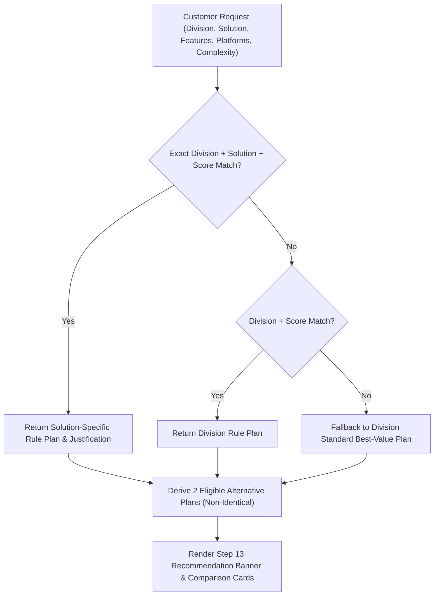

# STARX ALPHA LABS — DETERMINISTIC RECOMMENDATION RULES ENGINE
**Document ID:** `STARX-SPEC-REC-009`  
**Date:** November 18, 2026  
**Status:** COMPLETE & AUTHORITATIVE  
**Author:** Principal AI Systems Architect & Decision Engine Lead  

---

## 1. RECOMMENDATION ARCHITECTURE

The StarX recommendation engine uses **deterministic business logic** paired with **AI-generated justification templates**. Generative AI models are strictly prohibited from inventing pricing or overriding commercial plan eligibility.

### Multi-Factor Complexity Scoring Formula (1 to 10)
```
Complexity Score = (Integrations × 0.20) + (RealTime × 0.15) + (Security × 0.25) + (Platforms × 0.20) + (Scale × 0.20)
```
- **Integrations Factor (1–10):** Evaluates count of payment gateways, CRMs, WhatsApp Cloud APIs, and ERP webhooks.
- **Real-Time Factor (1–10):** Flags WebSocket streams, live driver tracking, live chat, or instant updates.
- **Security Factor (1–10):** Flags HIPAA, PCI-DSS, SOC-2, financial ledgers, or multi-tenant isolation.
- **Platform Factor (1–10):** 1 platform = 3; 2 platforms = 5; 3+ platforms (Web, iOS, Android, POS) = 8.
- **Scale Factor (1–10):** MAU projections, database concurrency, and high-availability uptime requirements.

---

## 2. DETERMINISTIC RECOMMENDATION DECISION TABLE

| Rule ID | Division | Solution Filter | Min Score | Max Score | Recommended Plan ID | Justification Template |
|---|---|---|---|---|---|---|
| `rule-web-low` | `starx-web` | `sol-web-biz` | 1 | 3 | `web-biz-starter` | Based on your essential page scope and requirement for a clean, rapid web presence, the Launchpad Business Flagship provides the optimal investment with zero bloat. |
| `rule-web-mid` | `starx-web` | `sol-web-biz` | 4 | 6 | `web-biz-growth` | Your project requires dynamic content management, multiple user sections, and structured SEO, making the Growth Corporate Flagship the ideal balanced platform. |
| `rule-web-ecom-std`| `starx-web` | `sol-web-ecom` | 1 | 5 | `web-ecom-starter` | For your direct-to-consumer online store with instant UPI checkout and catalog management, the D2C Ecommerce Launchpad delivers high conversion from day one. |
| `rule-web-ecom-high`| `starx-web` | `sol-web-ecom` | 6 | 10 | `web-ecom-growth` | Given your requirement for multi-warehouse stock sync, high transaction volume, and abandoned cart automation, the Growth Scale Commerce Engine is recommended. |
| `rule-apps-xplat-mvp`| `starx-apps`| `sol-app-xplat` | 1 | 5 | `app-xplat-mvp` | Your cross-platform mobile requirements are best served by our Universal Mobile MVP, providing native 60fps performance on both iOS and Android stores simultaneously. |
| `rule-apps-xplat-growth`| `starx-apps`| `sol-app-xplat` | 6 | 10 | `app-xplat-growth` | Because your mobile app requires real-time sync, offline SQLite persistence, and advanced payments, the Production Scale Mobile Product is the recommended architecture. |
| `rule-biz-pos-single`| `starx-biz` | `sol-biz-pos` | 1 | 4 | `biz-pos-single` | For single-location counter billing and barcode thermal printing, the Counter Express Cloud POS provides immediate speed and offline resilience. |
| `rule-biz-pos-multi`| `starx-biz` | `sol-biz-pos` | 5 | 10 | `biz-pos-multi` | Your multi-location requirements necessitate centralized stock reconciliation, shift audits, and multi-outlet sync provided by the Multi-Outlet Retail POS. |
| `rule-saas-mvp` | `starx-saas`| `sol-saas-mvp` | 1 | 5 | `saas-mvp-launch` | To validate your SaaS hypothesis with paying organizations, the SaaS Launchpad MVP equips you with multi-tenancy, Stripe billing, and team workspaces. |
| `rule-saas-pro` | `starx-saas`| `sol-saas-mvp` | 6 | 10 | `saas-mvp-pro` | Your scale requires metered usage calculation, webhook dispatchers, seat licenses, and enterprise audit vaults, matching the Growth Scale SaaS Engine. |
| `rule-ai-agent-starter`| `starx-ai` | `sol-ai-agent` | 1 | 5 | `ai-agent-starter` | Your automated workflow is best solved with our Autonomous Assistant Pod, executing structured tool calls with clear cost controls. |
| `rule-ai-agent-growth`| `starx-ai` | `sol-ai-agent` | 6 | 10 | `ai-agent-growth` | Your pipeline demands multi-agent coordination, document vector RAG, and human review gates provided by the Multi-Agent Autonomous Orchestration suite. |
| `rule-cust-squad-half`| `starx-custom`| `sol-cust-squad`| 1 | 6 | `cust-squad-half` | For targeted engineering delivery, our Fractional Engineering Pod (2 Senior Devs) embeds seamlessly into your development backlog. |
| `rule-cust-squad-full`| `starx-custom`| `sol-cust-squad`| 7 | 10 | `cust-squad-full` | Your enterprise requirements require full squad velocity. The Full Dedicated Engineering Pod (4 Engineers) provides architect-led continuous releases. |

---

## 3. RULE RESOLUTION ALGORITHM


