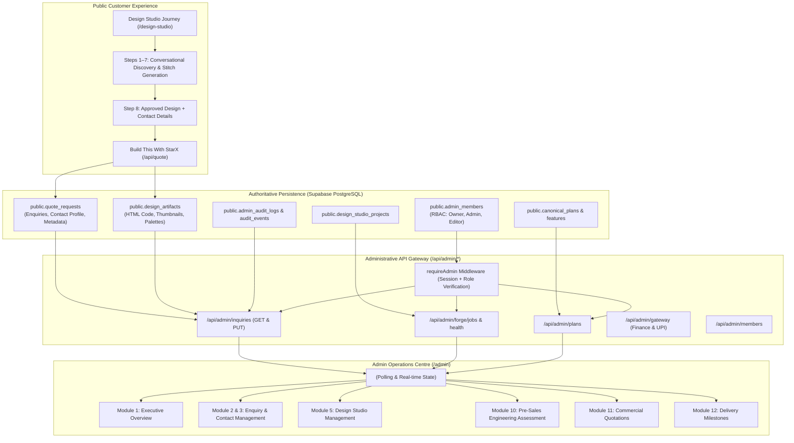

# STARX ALPHA LABS — ADMIN CENTRE ARCHITECTURE SPECIFICATION

**Project:** StarX Alpha Labs  
**Website:** https://www.starxalphalabs.online/  
**Tagline:** Build Smarter. Lead Tomorrow.  
**Branch:** `feat/portal-transformation`  
**Version:** 1.0.0  
**Date:** 18 November 2026

---

## 1. Architectural Overview & System Topology

The StarX Alpha Labs Admin Centre is an enterprise-grade business management and operations command console. It operates as the single administrative source of truth for incoming client briefs, Google Stitch-powered AI design generations, manual client outreach, pre-sales engineering assessments, commercial quotations, and ongoing active project milestones.

---

## 2. Component Structure & Data Flow

### 2.1 Customer Ingestion to Admin Pipeline
1. **Public Intake:** When a prospect completes the personalized AI demo flow in Design Studio (`/design-studio`), Step 8 prompts for verified contact coordinates.
2. **Atomic Ingestion (`/api/quote`):**
   - Validates submission payload against `QuoteFormSchema`.
   - Generates human-readable reference code `STX-ENQ-YYYYMM-XXXX`.
   - Links the project and artifact via `designStudioOrchestrator.approveArtifact()`.
   - Inserts the complete enquiry into `public.quote_requests` with metadata containing project brief, Stitch artifact screenshots, download URLs, and contact preferences.
3. **Admin Hydration (`SuperAdminPortal.tsx`):**
   - Asynchronously queries `GET /api/admin/inquiries?type=all` upon mounting.
   - Enriches raw rows into `UnifiedLead[]` data model.
   - Executes non-blocking polling every 30 seconds to maintain real-time situational awareness.

### 2.2 Enquiry Workspace & Direct Contact Governance
- Section 27 Operations Policy: **Never mark a customer contacted automatically upon clicking Call or WhatsApp.**
- Clicking `tel:` or WhatsApp opens the native client without state mutation.
- A mandatory **Record Contact Outcome** form captures:
  - Channel: Phone Call, WhatsApp, Email, Video Conference.
  - Outcome: 8 standardized business choices (*Interested, Callback Requested, Requirements Changed, Left Voicemail, etc.*).
  - Summary Notes.
  - Next Follow-up Date.
- Submitting the form issues a `PUT /api/admin/inquiries`, appending to `contactHistory`, updating the status, and scheduling the next reminder.

---

## 3. Database Alignment & CHECK Constraint Safety

Because PostgreSQL tables in existing environments enforce check constraints on legacy columns (e.g. `quote_requests.status CHECK (status IN ('new', 'reviewing', 'quoted', 'declined', 'won'))`), the architecture implements a dual-layer state model:
1. **Granular Operational Status (`metadata.leadStatus`):** Full 12-stage enterprise workflow (`new`, `assigned`, `attempted_contact`, `contacted`, `needs_assessment`, `assessment_complete`, `followup_required`, `quote_prepared`, `quotation_sent`, `negotiation`, `converted`, `not_interested`, `on_hold`, `closed`).
2. **Database Column Status (`quote_requests.status`):** Safely mapped via `DB_QUOTE_STATUS_MAP` to `'new' | 'reviewing' | 'quoted' | 'won' | 'declined'`.
3. **Result:** Absolute schema compliance without runtime constraint violations, preserving complete fidelity in the admin interface.

---

## 4. Security Architecture & RBAC

1. **Authentication Boundary:** Every `/api/admin/*` endpoint executes `requireAdmin(['owner', 'admin', 'editor'])`.
2. **Direct DB Verification:** `requireAdmin` does NOT trust client headers or user metadata; it performs a privileged verification against `public.admin_members`.
3. **Privilege Tiers:**
   - **Owner (`owner`):** Unrestricted access, user provisioning, system settings, financial adjustments, bootstrap protection.
   - **Administrator (`admin`):** Full operational access, enquiry management, quotations, project staging, CMS.
   - **Editor (`editor`):** Read-only operational oversight, note logging, content editing; cannot alter financial records or user permissions.
4. **Audit Logging:** Every administrative mutation invokes `logAdminAction()`, writing an immutable trace into `public.admin_audit_logs`.
