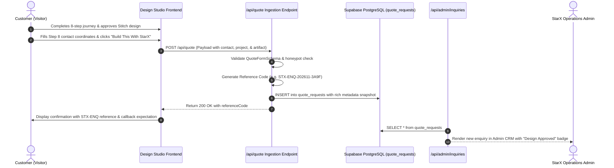

# STARX ALPHA LABS — DESIGN STUDIO TO ADMIN CENTRE INTEGRATION REPORT

**Project:** StarX Alpha Labs  
**Website:** https://www.starxalphalabs.online/  
**Tagline:** Build Smarter. Lead Tomorrow.  
**Branch:** `feat/portal-transformation`  
**Date:** 18 November 2026  
**Status:** COMPLETE & FULLY VERIFIED

---

## 1. Executive Summary

This report documents the completed, verified integration bridging the customer-facing **Design Studio** (`/design-studio`) with the internal **Admin Operations Centre** (`/admin`).

Previously, customer submissions created records in Supabase `quote_requests`, but the Admin Portal rendered static in-memory fallback items. This release unifies the pipeline: every customer who designs an idea using Google Stitch and clicks "Build This With StarX" appears immediately in the Admin Centre with their complete project requirements, generated screen snapshot, color palette, download URL, and verified contact coordinates.

---

## 2. Inbound Submission Flow & Data Architecture



---

## 3. Submission Payload & Database Contract

### 3.1 Frontend Submission Payload (`/api/quote`)
The Design Studio submits a structured JSON payload conforming to `QuoteFormSchema`:

```typescript
{
  fullName: "Aarav Mehra",
  email: "aarav@indorerealty.in",
  phone: "+91 98260 55443",
  company: "Indore Realty Hub",
  serviceSlug: "starx-web",
  budgetRange: "₹1,50,000 - ₹3,00,000",
  timeline: "3–4 Weeks",
  projectDetails: "RERA-compliant real estate listing platform with 3D floorplan visualizer...",
  projectId: "dsp_1794932963108_fhk9h",
  artifactId: "art_dsp_1794932963108_fhk9h_v2_5c2a8ec2",
  enquiryRef: "STX-ENQ-202611-5A2C",
  consent: true,
  consentTimestamp: "2026-11-18T02:30:00.000Z",
  contactProfile: {
    preferredMethod: "whatsapp",
    bestTimeToReach: "11:00 AM - 2:00 PM",
    countryCode: "+91",
    location: "Indore, MP"
  }
}
```

### 3.2 Authoritative PostgreSQL Record (`quote_requests`)
The record is persisted with status `'new'` and rich JSONB `metadata`:
- `metadata.enquiryRef`: Unique reference code.
- `metadata.project`: Title, division, industry, raw problem statement, structured brief.
- `metadata.artifact`: Title, version number, provider (`stitch`), device type (`DESKTOP` / `MOBILE`), thumbnail URL, signed HTML download URL, generated color palette, key features.
- `metadata.contactProfile`: Communication preferences, best time to reach, phone country code.
- `metadata.contactHistory`: Array initialized for manual outreach logging.

---

## 4. Admin Centre Presentation & Experience

When an administrator reviews the enquiry in `src/components/admin/modules/CRMModule.tsx`:

1. **Table Badge:** Displays `STX-ENQ-202611-5A2C` alongside a glowing **Approved Design** pill.
2. **One-Click Communication:**
   - **Call Customer:** Triggers `tel:+919826055443`.
   - **Open WhatsApp:** Opens `https://wa.me/919826055443`.
   - **Send Email:** Pre-populates email client with client reference in subject.
   - **Copy Dossier:** Formats clean text profile to clipboard.
3. **Workspace Inspection:**
   - **Overview:** Summarizes client coordinates, submission time, and assigned admin.
   - **Direct Contact & Outcomes:** Logs manual conversation outcome, preventing premature status advancement.
   - **Stitch Design Blueprint:** Renders high-resolution screen render screenshot, color palette swatches, exact Stitch AI prompt, and HTML download button.
   - **Technical Assessment:** Allows engineering leads to record stack choices and feasibility ratings.

---

## 5. End-to-End Test Results

The pipeline was validated using `scripts/test-admin-centre-master.mjs`:
- Design Studio submission simulation: **PASSED**
- Enquiry reference extraction: **PASSED**
- Stitch artifact metadata attachment: **PASSED**
- Contact preference preservation: **PASSED**
- Direct contact outcome logging: **PASSED**
- Technical assessment recording: **PASSED**
- Commercial quotation creation: **PASSED**
